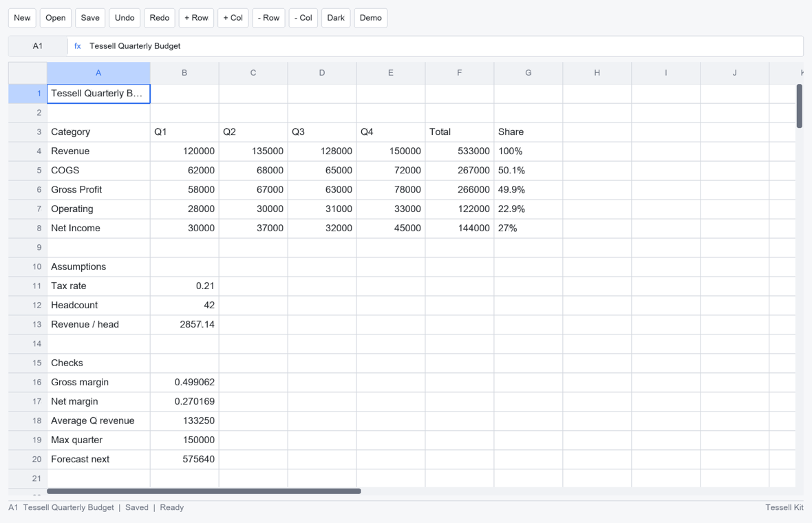
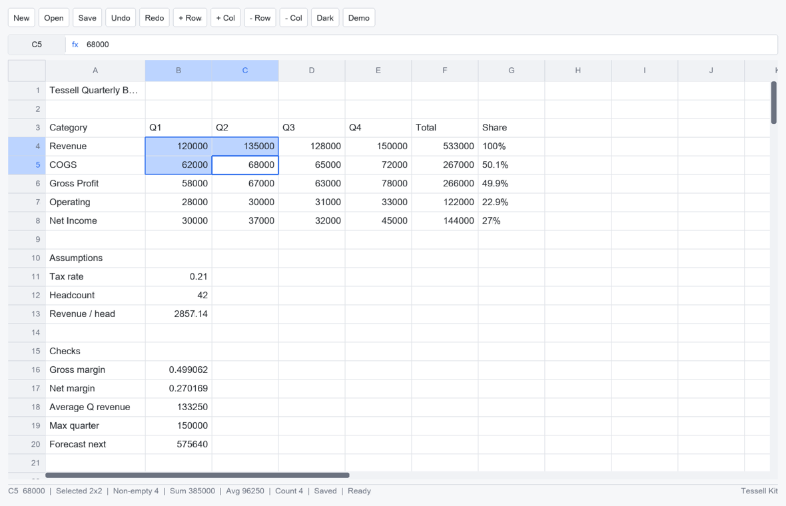
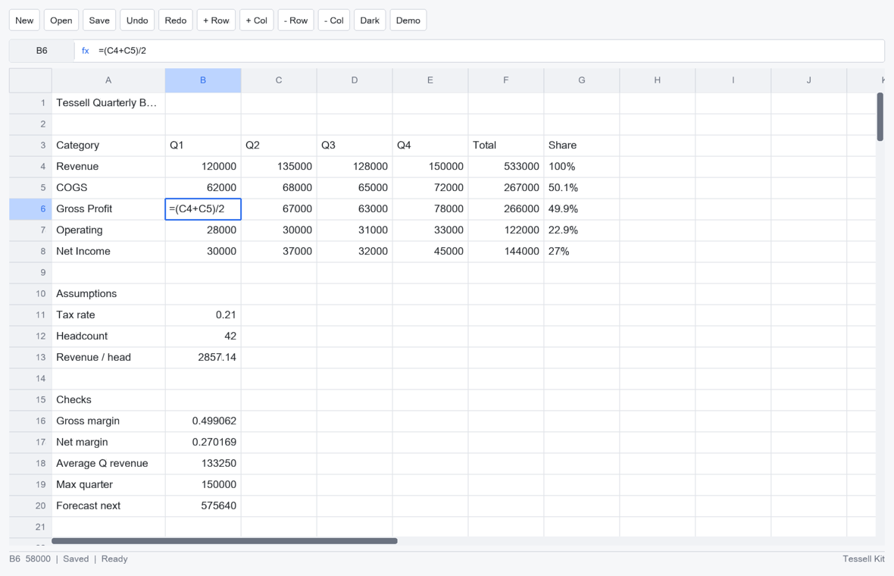
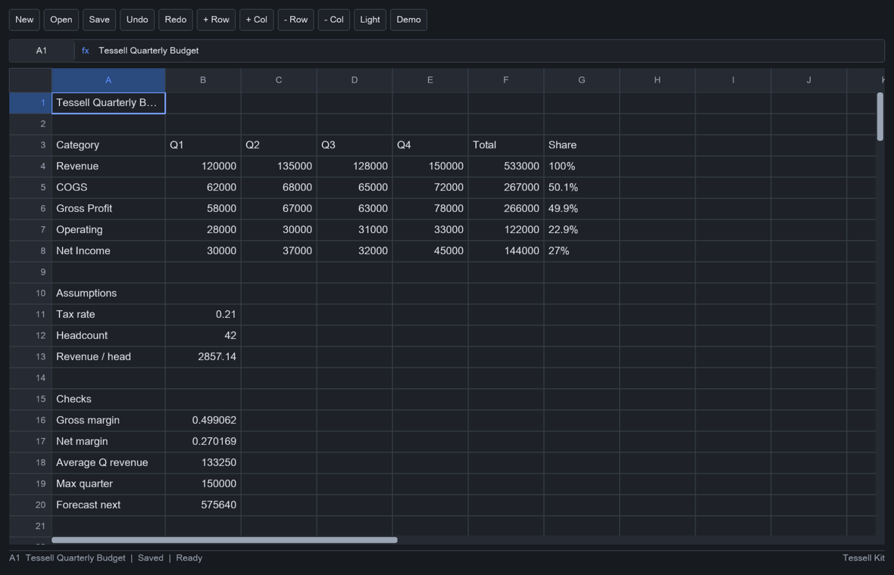
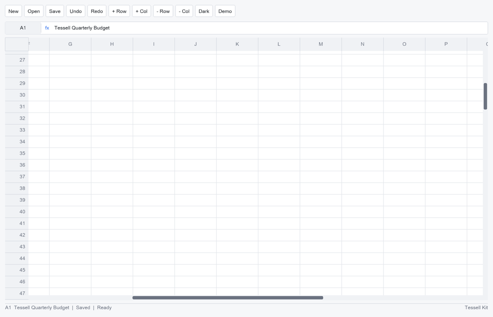

# Tessell Sheets

用 [Tessell](https://github.com/ShiningRay/tessell) 和 `Tessell::Kit` 构建的电子表格 demo。



## 功能

- **二维网格**：200 × 26 单元格，可滚动、冻结行号/列标表头、滚轮与滚动条拖动。
- **公式引擎**：`+ - * / ^ %`、比较运算、字符串拼接；`SUM AVERAGE MIN MAX COUNT COUNTA IF IFERROR ROUND ABS SQRT CONCAT AND OR NOT`；A1 引用、`A1:B3` 区间、`$A$1` 绝对引用。
- **错误值**：`#VALUE! #REF! #DIV/0! #NUM! #NAME? #PARSE! #CYCLE!`，循环引用会被检测而不是死循环。
- **单元格编辑**：双击或直接输入进入编辑，Enter/Tab 提交并移动，Escape 取消；grapheme 级光标与选区。
- **选择与剪贴板**：拖动选区、Shift 扩展、整行/整列/全选；Cmd/Ctrl+C/X/V 以 TSV 往返。
- **工作簿操作**：CSV 打开/保存、插入/删除行列、撤销/重做、明暗主题切换。
- **状态栏**：活动单元格、选区尺寸、非空计数、数值 Sum/Avg/Count。

## 截图

| 选区与状态栏 | 单元格编辑 |
|---|---|
|  |  |

| 深色主题 | 滚动与冻结表头 |
|---|---|
|  |  |

## 运行

依赖 Crystal 1.21+、SDL2、FreeType、HarfBuzz。

```bash
shards install
tools/run.sh
```

`tools/run.sh` 会在 macOS 自动加 `-L/opt/homebrew/lib`，并先创建 `bin/`。也可以手动：

```bash
mkdir -p bin
crystal build src/tessell_sheet_demo.cr -o bin/sheet_demo --link-flags "-L/opt/homebrew/lib"
./bin/sheet_demo
```

Linux（Ubuntu/Debian）：

```bash
sudo apt install libsdl2-dev libfreetype6-dev libharfbuzz-dev libgl1-mesa-dev
tools/run.sh
```

Windows：安装 SDL2 开发库并确保 `SDL2.dll` 在 PATH 或 exe 目录。

### 参数

| 参数 | 说明 |
|---|---|
| `--frames=N` | 渲染 N 帧后退出（CI/截图用） |
| `--screenshot=path.ppm` | 最后一帧写入 PPM |
| `--theme=dark` / `--theme=light` | 初始主题 |
| `--open=file.csv` | 启动时打开 CSV |
| `--scenario=selection/editing/scrolled` | 脚本化交互（用于截图回归） |

### 快捷键

| 按键 | 行为 |
|---|---|
| 方向键 / Enter / Shift+方向键 | 移动活动单元格 / 扩展选区 |
| Tab / Shift+Tab | 单元格间移动 |
| Escape | 退出编辑；空闲时把焦点交回工具栏 |
| Ctrl/Cmd+C/X/V | 复制 / 剪切 / 粘贴 TSV |
| Ctrl/Cmd+A | 全选 |
| Ctrl/Cmd+Z / Ctrl/Cmd+Shift+Z 或 Ctrl/Cmd+Y | 撤销 / 重做 |
| Ctrl/Cmd+S / O / N | 保存 / 打开 / 新建 |
| Delete | 清空选区 |
| Backspace | 清空当前单元格并进入编辑 |

## 测试

```bash
crystal spec
```

覆盖公式词法/求值、错误值与循环引用、CSV 往返、行列操作、快照恢复、网格坐标/滚动/导航/编辑/剪贴板、应用装配与 a11y。

真实窗口截图冒烟：

```bash
tools/run.sh --frames=3 --screenshot=/tmp/sheet.ppm
ffmpeg -y -i /tmp/sheet.ppm /tmp/sheet.png
```

## 结构

| 文件 | 职责 |
|---|---|
| `src/sheet_demo/formula.cr` | 值模型、词法/语法分析、求值器 |
| `src/sheet_demo/sheet.cr` | 单元格存储、CSV、插入删除、快照、演示数据 |
| `src/sheet_demo/grid.cr` | `SheetGrid`：坐标、选区、编辑、滚动、绘制 |
| `src/sheet_demo/widgets.cr` | 公式栏、状态栏、外层布局 |
| `src/sheet_demo/app.cr` | 工作簿状态、工具栏、撤销/重做、文件 IO |
| `src/sheet_demo/sdl_host.cr` | SDL2/OpenGL 宿主（框架尚无公共 Runner） |

`src/sheet_demo.cr` 是纯逻辑入口，不依赖 SDL；spec 只 require 它。

## 已知限制

- 只有单工作表；没有合并单元格、冻结窗格、列宽拖拽、自动换行。
- 公式不支持跨表引用、数组公式、`COUNTIF/SUMIF` 等条件聚合。
- 撤销是整表快照（100 步上限），不是按操作增量。
- CSV 打开会重置窗口内数据；不保留公式外的单元格风格。
- 真实窗口证据来自 macOS arm64 SDL2/OpenGL + Retina 2x；Windows/Linux 未实测。
- 未接平台 IME 预编辑；输入法走 SDL_TEXTINPUT 已提交文本。

## 开发摩擦

开发中撞到的框架缺口与建议已整理到 [docs/friction-log.md](docs/friction-log.md)，并提交为 Tessell issue：

- [#14](https://github.com/ShiningRay/tessell/issues/14) DPI 文本度量单位
- [#15](https://github.com/ShiningRay/tessell/issues/15) Painter z-order 与文本 clip
- [#16](https://github.com/ShiningRay/tessell/issues/16) Root 消费 Tab
- [#17](https://github.com/ShiningRay/tessell/issues/17) 二维滚动 / 冻结表头
- [#18](https://github.com/ShiningRay/tessell/issues/18) Crystal 语言/API 坑

## License

MIT
